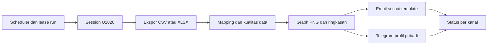

# Rancangan Huawei KPI Reporting

Status: **kerangka nonaktif**. Draft dapat disimpan dan dinilai kelengkapannya. Tidak ada login browser, pengambilan KPI, pengiriman email/Telegram, atau worker terjadwal yang berjalan. Pengujian U2020 dan kanal pengiriman dilakukan nanti pada komputer/lingkungan yang memiliki akses, sesuai permintaan pengguna.

## Alur yang disarankan

CSV menjadi pilihan awal karena tabel mentah mudah diperiksa dan dipetakan. XLSX tetap menjadi pilihan adapter ketika ekspor U2020 hanya tersedia sebagai workbook atau memiliki beberapa sheet. Pilihan ini perlu dikonfirmasi dari contoh ekspor; adapter XLSX reporting belum diterapkan. Reader XLSX LLD tidak dianggap otomatis cocok untuk tabel KPI.

Setiap hasil graph memakai satu dataset/window yang sama untuk email dan Telegram. Metadata laporan mencatat source, NE/filter, periode data, timezone, waktu pengambilan, unit, jumlah sampel valid, serta status kualitas. Nilai kosong tidak diganti nol. Kegagalan ekspor atau data stale menghasilkan status gagal/perlu tindakan, bukan graph lama yang diberi label seolah data terkini.

## Browser dan session U2020

Pilihan utama ialah browser profile khusus monitoring. Pengguna login manual di browser itu; session berikutnya memakai profile yang sama selama masih valid. Playwright menyediakan persistent context dengan direktori profile tersendiri. Profile default Chrome sehari-hari tidak menjadi target otomatis. Jika memang perlu memakai browser yang sudah terbuka, koneksi Chromium lewat CDP dapat menjadi adapter alternatif setelah browser disiapkan khusus; jalur ini memiliki dukungan lebih terbatas dibanding protokol Playwright. [BrowserType / persistent context dan CDP](https://playwright.dev/python/docs/api/class-browsertype).

Session cookies/auth state diperlakukan sebagai kredensial lokal. Simpan di direktori data yang diabaikan Git; jangan menaruh state tersebut di draft, log, contoh, atau source. [Playwright authentication](https://playwright.dev/python/docs/auth).

Adapter harus mendeteksi halaman login, expired session, MFA, dan hasil ekspor yang sebenarnya HTML login. Session invalid menghentikan pengambilan dan membuat kebutuhan login ulang terlihat. Kerangka tidak mengasumsikan selector, endpoint internal, atau cara melewati MFA. Bila U2020 menyediakan API/report schedule resmi, dokumentasinya dapat dipakai untuk mengganti browser adapter.

## Kontrak kode yang tersedia

| Modul | Peran | Saat ini |
| --- | --- | --- |
| `backend/workspace/reporting/config.py` | Schema draft dengan batas input, timezone, template, dan secret reference | Berfungsi lokal; `enabled` hanya menerima `false` |
| `planner.py` | Window laporan, stable delivery key, retry delay, keputusan state pengiriman | Fungsi murni tanpa scheduler aktif |
| `csv_reader.py` | CSV UTF-8 koma, header eksplisit, timestamp ISO, mapping KPI ke titik data | Parser generik; bukan mapping U2020 yang sudah teruji |
| `contracts.py` | Source, renderer, secret resolver, email/Telegram, state store, runner | Adapter dan runner menolak eksekusi dengan `ReportingNotConfigured` |

Titik KPI memiliki bentuk `timestamp, entity, metric, value, unit`. Angka memakai `Decimal`; zero yang sah tetap zero. Pemeriksaan CSV mencakup kolom hilang/berulang, jumlah kolom, waktu ambigu/future, nilai kosong/non-numerik, duplicate timestamp/NE/KPI, stale per NE/KPI, dan gap bila granularity diberikan. Pembaca dibatasi 10 MB, 100.000 record, 128 kolom, 200.000 titik KPI, serta 1.000 issue. Melebihi batas menolak proses, bukan menghasilkan sukses parsial. `can_chart` hanya benar jika ada titik valid dan tidak ada issue. Expected NE/filter harus ditambahkan setelah daftar NE diberikan agar NE yang sepenuhnya hilang dapat terdeteksi.

Schema menerima template teks dengan placeholder `{report_name}`, `{window_start}`, `{window_end}`, dan `{summary}`. Akses atribut, conversion, dan format expression ditolak. Renderer graph serta penyusunan MIME email belum dihubungkan; tidak ada gambar atau status sukses buatan.

`default_draft()` mengembalikan konfigurasi awal tanpa secret. `analyze_draft(config)` mengembalikan `active:false`, `can_activate:false`, daftar kebutuhan yang kurang, status komponen, alur, dan preview window. Field `next_window` adalah window data tertutup terakhir yang sudah melewati delay pengumpulan, bukan bukti sebuah job telah dijadwalkan.

## Jadwal dan keandalan

Draft menentukan interval, lookback, delay data, timezone tampilan, serta batas mulai/akhir dengan offset ISO. Cadence planner memakai interval tetap dalam UTC, berjangkar pada waktu mulai. Contoh: mulai 00:00, interval 60 menit, delay 10 menit menghasilkan window pertama 00:00–01:00 yang layak diproses pada 01:10. Batas monitoring akhir bersifat eksklusif. Jika diperlukan laporan final setelah akhir periode, kebijakan itu harus ditentukan sebelum scheduler diaktifkan.

Worker kelak berjalan terpisah dari request web dan tab browser. Menutup tab Ruang tidak boleh menghentikan jadwal. Kandidat untuk mesin Windows adalah proses/service khusus atau scheduled launcher yang menjalankan worker; pemilihan akhirnya mengikuti lingkungan target. Huey sudah ada dalam proyek, tetapi tidak ada periodic task reporting yang didaftarkan oleh kerangka ini.

State store durable perlu memiliki dua tingkat:

- `ReportRun`: unique report/config-version + window slot, lease expiry, tahapan, hash sumber/gambar, status dan reason code. Atomic lease mencegah run bertumpuk. Seleksi NE/template dibekukan pada snapshot konfigurasi run.
- `ReportDelivery`: unique run + profil + kanal, attempt, next retry, provider receipt, state `pending/sending/sent/failed/unknown`. Email sukses dan Telegram gagal disimpan terpisah; retry Telegram tidak mengirim email lagi.

`delivery_key()` membedakan report, profile, slot, dan kanal. Retry memakai backoff terbatas. Bila koneksi terputus setelah request mungkin telah diterima, state menjadi `unknown`; jangan otomatis mengirim ulang karena SMTP dan Telegram tidak menjamin deduplikasi menggunakan key lokal. Lease `sending` yang kedaluwarsa juga perlu rekonsiliasi. Idempotency lokal mengurangi duplikasi tetapi tidak membuktikan pengiriman exactly-once.

Kebijakan missed-run, batas retry, retensi raw export/graph/log, quarantine ekspor rusak, notifikasi session expired, dan siapa yang merespons kegagalan masih perlu keputusan. Komputer target harus tetap menyala/tidak sleep dan memiliki akses bersamaan ke U2020/VPN, SMTP, dan Telegram selama libur. Draft saat ini hanya tersimpan lokal; tidak menjadi scheduler.

## Email dan Telegram per profil

Email direncanakan sebagai HTML sesuai template, dengan PNG inline melalui Content-ID dan opsi attachment. SMTP memerlukan host, port, TLS, From, autentikasi, dan timeout yang disepakati. Python menyediakan SMTP dan pembuatan message MIME; keduanya belum dipanggil dalam kerangka ini. [SMTP Python](https://docs.python.org/3.14/library/smtplib.html), [contoh MIME/inline image](https://docs.python.org/3.14/library/email.examples.html).

Setiap profil penerima menyimpan nama **reference environment variable**, bukan nilai password/token. Contoh: `RUANG_REPORT_SMTP_PERSONAL` dan `RUANG_TELEGRAM_PERSONAL`. Secret resolver belum diterapkan. Bot token, password SMTP, cookies, dan auth state jangan dikirim melalui form draft. Untuk instalasi lain/profil lain, gunakan reference, bot, dan chat ID milik pengguna tersebut. Profil pengiriman bukan akun multiuser; aplikasi tetap satu pengguna lokal.

Setup Telegram yang perlu dilakukan nanti:

1. Pengguna membuat bot sendiri melalui BotFather dan menyimpan token pada credential store/environment di mesin target. [BotFather](https://core.telegram.org/bots/features#botfather).
2. Pengguna membuka bot dan mengirim `/start`; bot tidak dapat memulai percakapan pribadi sendiri. [Telegram Bots FAQ](https://core.telegram.org/bots/faq).
3. Ambil chat ID melalui alur pairing/getUpdates yang terkontrol; verifikasi pemiliknya. getUpdates tidak berjalan bersamaan dengan webhook aktif. Pengiriman graph menggunakan `sendPhoto` dan caption yang relevan, tanpa memasukkan token dalam log. Batas API yang perlu diperiksa saat adapter dibuat: foto maksimum 10 MB dan caption maksimum 1024 karakter setelah parsing entities. [Telegram Bot API](https://core.telegram.org/bots/api#sendphoto).

Caption memuat periode, NE/filter, KPI utama, unit, status normal/threshold bila definisinya diberikan, serta waktu pengambilan. Jangan menambahkan kesimpulan normal/abnormal sebelum threshold dan formula disetujui. Untuk data terlalu sensitif bagi Telegram, operator perlu menentukan graph/label apa yang boleh dikirim.

## Informasi yang perlu diberikan

| Kebutuhan | Detail yang diminta |
| --- | --- |
| U2020 | Versi, base URL, browser, jaringan/VPN/proxy, TLS/certificate, login SSO/MFA, masa berlaku session |
| Halaman dan ekspor | Urutan klik/path halaman, nama report, filter NE, pilihan periode, tombol export, nama file, waktu tunggu dan batas data |
| Contoh data | CSV dan/atau XLSX representatif, sheet/header, delimiter/encoding, contoh nilai kosong, timezone timestamp, granularity, apakah data cumulative atau rate |
| KPI | Daftar KPI/NE, label/unit, rumus/aggregation, threshold, arah baik/buruk, per-NE atau gabungan, window dan delay publikasi data |
| Graph | Contoh graph, panel, judul/legend, warna, ukuran PNG, urutan KPI, penanganan missing/stale data |
| Email | SMTP/SSO/relay yang diizinkan, From/To/CC, TLS, template subject/HTML, inline/attachment, pengiriman failure alert |
| Telegram | Bot masing-masing pengguna, chat ID yang diverifikasi, reference secret, template caption, data yang boleh dikirim |
| Jadwal libur | Tanggal mulai/akhir dan timezone, interval, jam aktif, kebutuhan laporan final, catch-up setelah restart, retry dan tujuan notifikasi gagal |
| Mesin eksekusi | Windows/host yang tetap menyala, akses desktop untuk browser, anti-sleep, hak menjalankan service/worker, koneksi bersamaan intranet dan internet |
| Operasional | Retensi/backup, batas ukuran, penyamaran data/log, daftar penerima, cara menghentikan monitoring, kriteria penerimaan |

## Pengujian

Tes lokal hanya memakai metadata/CSV sintetis serta mock adapter. Tidak ada login U2020, email, bot API, atau scheduler live yang diuji di laptop ini. Tes lingkungan target kelak harus mencakup login ulang/session expiry, ekspor lambat/gagal, data kosong/stale/gap, host restart, dua run bersamaan, satu kanal gagal, timeout ambigu, dan penghentian periode monitoring. Integrasi baru dapat diaktifkan setelah hasil uji target diterima.
